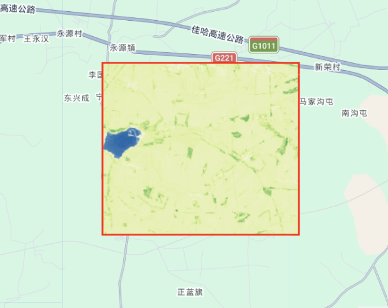
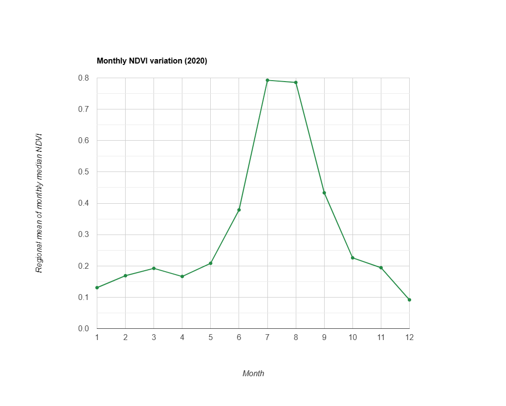

# Sentinel-2 NDVI Mapping and Monthly Seasonal Analysis

This project uses Google Earth Engine to map annual median NDVI
and examine monthly variation across a study area in northeastern
China during 2020.

The workflow includes Sentinel-2 surface reflectance filtering,
cloud and shadow masking, NDVI calculation, temporal compositing,
regional statistics and data export.

## Study area

The study area covers approximately 30.27 km² within Sentinel-2
MGRS tile `52TCR`. It contains agricultural fields, water bodies,
roads and settlements.

Its extent is approximately 127.0174–127.0933°E
and 45.7243–45.7705°N.

## Data and method

1. Select `COPERNICUS/S2_SR_HARMONIZED` imagery for 2020.
2. Retain images with scene-level cloud percentage below 40%.
3. Mask invalid pixels, cloud shadows, clouds, cirrus and snow/ice
   using the SCL band.
4. Calculate NDVI as `(B8 - B4) / (B8 + B4)`.
5. Calculate annual and monthly per-pixel median NDVI composites.
6. Calculate the regional mean of each monthly composite
   at a 30 m sampling scale.
7. Export the annual NDVI raster at 10 m and the monthly
   statistics as CSV.

The initial filtering retained 91 images. Monthly input counts
ranged from 3 to 11 images.

## Results

The monthly series shows pronounced seasonal variation.
NDVI increased towards summer, remained high in July and August,
and declined towards winter.

| Metric | Result |
|---|---:|
| Study-area size | Approximately 30.27 km² |
| Months with valid regional results | 12 |
| Month with highest NDVI | July 2020 |
| Highest monthly value | 0.7926 |
| Month with lowest NDVI | December 2020 |
| Lowest monthly value | 0.0917 |
| Monthly NDVI range | 0.7010 |

These monthly values are regional means of monthly median
composites, rather than individual satellite observations.

## Figures

### Annual median NDVI

### Monthly NDVI variation

## Repository contents

- `ndvi_analysis.js`: complete Google Earth Engine workflow
- `data/`: data sources, study-area coordinates and filtering settings
- `exports/`: numerical GeoTIFF and monthly CSV
- `results/`: figures and result descriptions

## Running the analysis

Open the Google Earth Engine Code Editor and paste the contents
of `ndvi_analysis.js` into a new script.

Run the script to display the annual map, monthly chart and
summary statistics. Start the export tasks from the Tasks panel
to save the GeoTIFF and CSV to Google Drive.

A Google Earth Engine account with an enabled project is required.

## Limitations

Cloud masking may leave residual contamination, and valid
observation coverage can differ between months. This simplified
workflow does not apply a minimum monthly valid-coverage threshold.

Regional statistics include water bodies and built surfaces
as well as vegetation. They are not cropland-only measurements.

The annual composite and monthly series describe different
temporal summaries. This single-year analysis does not establish
a long-term vegetation trend or independently validate crop
health, crop type or yield.

## Tools

Google Earth Engine, JavaScript, Sentinel-2, GIS and remote sensing.

## Data source

[Google Earth Engine Sentinel-2 SR Harmonized catalogue](https://developers.google.com/earth-engine/datasets/catalog/COPERNICUS_S2_SR_HARMONIZED)
